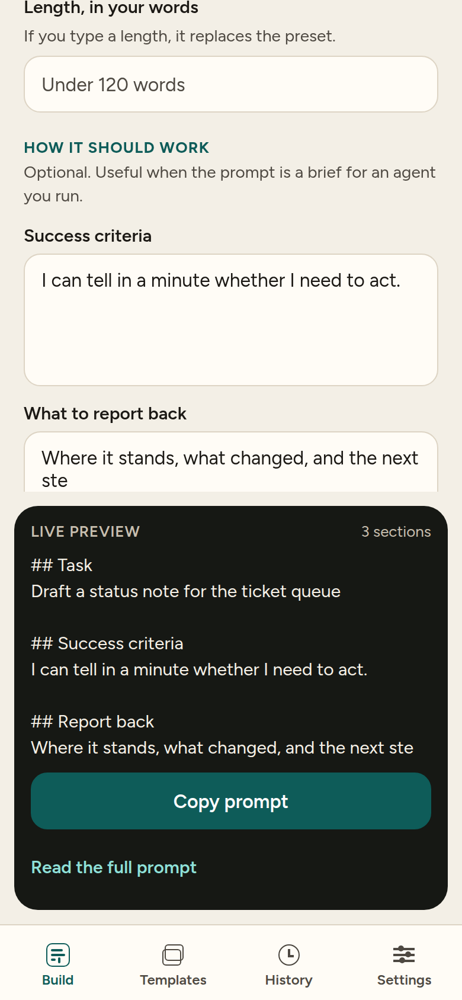
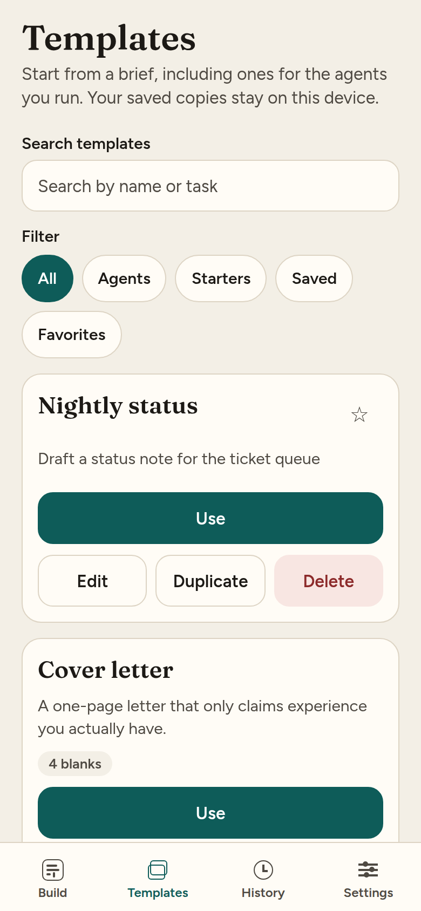
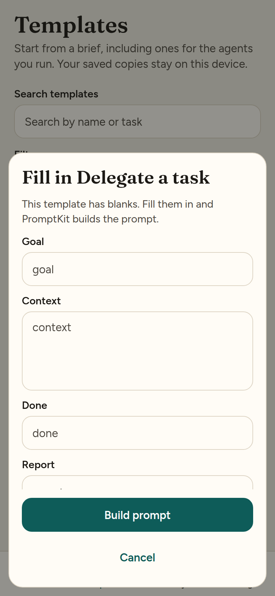
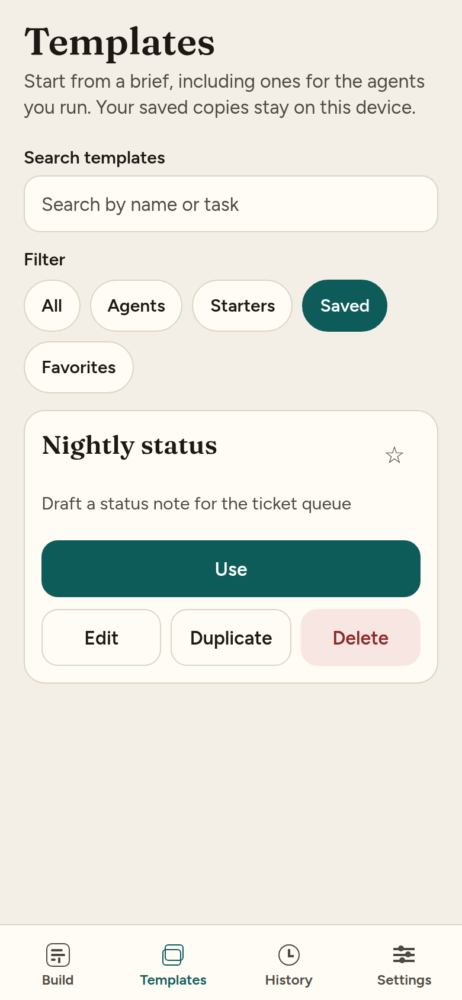
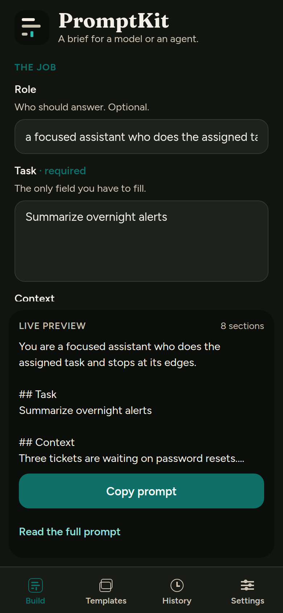

# PromptKit

[](https://github.com/Mercury101999/promptkit/actions/workflows/ci.yml)
[](https://github.com/Mercury101999/promptkit/actions/workflows/pages.yml)
[](LICENSE)

PromptKit turns a short form into a clean prompt you can paste into ChatGPT, Grok, Claude, or an agent you run. I built it because I was retyping the same brief every time: who should answer, what the job is, what done looks like, and what not to do.

I use it on my phone. The main way to open it is the [live demo](https://mercury101999.github.io/promptkit/), which installs like an app and keeps working offline after the first visit. There is no account and no AI API. The prompt is assembled on the device.

A lot of my use is briefing the bots I run: a job-search manager, a coding partner, a CompTIA tutor, and a research assistant. The same form covers a one-off chat and a standing brief for one of those agents. Agent templates ask for the goal, the limits, what to report back, and when to ask before acting.

## Install it on your phone

Open [https://mercury101999.github.io/promptkit/](https://mercury101999.github.io/promptkit/) once while you are online.

**iPhone (Safari)**

1. Tap the Share button.
2. Tap **Add to Home Screen**.
3. Open PromptKit from the icon. After that first visit, it opens without a connection.

**Android (Chrome)**

1. Open the menu and tap **Install app** or **Add to Home screen**.
2. Open PromptKit from the launcher. It works offline after the first visit.

## What it looks like

The preview updates as you type, and empty sections are left out.



Starters for everyday writing, plus your own saved templates.



A template with `{{placeholders}}` asks for those values before it builds the prompt.



Saved templates can be favorited, edited, duplicated, or deleted.



Light and dark follow the phone, and you can pin one in Settings.



## Features

- **Builder.** Role, task, context, audience, tone, output format, length, success criteria, what to report back, when to ask first, constraints, and examples. Only the task is required.
- **Live preview.** A structured prompt: a role line, then only the sections you filled in.
- **Copy and share.** One tap copies it, with a clear "Copied" confirmation. Share opens the system share sheet when the browser or phone has one.
- **18 starters.** Cover letter, explain a concept, CompTIA-style study quiz, troubleshooting, email rewrite, code review, summary, interview practice, daily plan, notes to a checklist, ticket reply, and error explanation. Six more are for agents: delegate a task, standing instructions, a recurring routine, a hand-off, a status update, and a decision with options.
- **Your templates.** Save the form under a name. Edit, duplicate, favorite, search, and delete (delete asks first).
- **Blanks.** `{{placeholders}}` in a template become a short form. The prompt is built after you fill them.
- **History.** The last 50 prompts you copied, with a way to clear them.
- **Backup.** Export saved templates as JSON, or paste JSON back in. Imports are checked before they are kept.
- **Themes.** System, light, or dark. Large tap targets, labeled controls, visible focus, and reduced motion is respected.
- **Offline.** The installed web app loads from a service worker after the first visit.

## Tech stack

- Expo SDK 58, Expo Router, and strict TypeScript. The same project runs on iOS, Android, and web.
- AsyncStorage for the draft, templates, history, and theme. On the web that is local storage.
- Jest and React Native Testing Library.
- A static web export published to GitHub Pages at `/promptkit/`, with a web app manifest and a service worker.

## Architecture

The prompt rules do not live in the screens. `src/lib/prompt.ts` decides which sections to print. `src/lib/variables.ts` finds and fills `{{tokens}}`. `src/lib/reducer.ts` is the state machine for saving, editing, history, and the 50-item cap. `src/lib/transfer.ts` checks an imported JSON file before anything is stored.

Screens in `src/app` render that state. The web shell is `src/app/+html.tsx`: manifest link, Apple touch icon, theme color, and the service worker registration. `npm run build:web` exports the site and then `scripts/generate-sw.mjs` precaches it under the `/promptkit/` prefix, which is the path GitHub Pages uses for this repo.

```
src/lib        prompt assembly, templates, storage, import checks
src/store      load and save that state on the device
src/app        Build, Templates, History, Settings
scripts        icons and the service worker
```

## Run it

```bash
npm install
npm start          # Expo dev server
npm run web        # web, at /promptkit/
npm test           # unit tests and component tests
npm run typecheck
npm run lint
npm run build:web  # static site in dist/
```

CI on pull requests runs the typecheck, lint, tests, and the web export.

## What I learned

A prompt is easier to reuse when it is a short document instead of one long paragraph. Leaving a section out when the field is empty matters more than having a clever template for every case.

Briefing one of my agents is the same shape as asking a chat model for help. The useful extra lines are what "done" means, what I want reported, and when the agent should stop and ask.

Shipping the site under `/promptkit/` was the tricky part. The router, the script URLs, the manifest scope, and the service worker all have to agree on that prefix. If one of them points at `/`, the home-screen app opens a blank page.

Copying on an iPhone also has a catch. Safari drops the clipboard write if you wait on anything else first, so the copy starts inside the tap and the history is saved after.

I kept the screen tests small on purpose. The rules are plain functions, and the component tests only check that the form, the copy button, and the blanks dialog are wired up. That stays reliable on a slow GitHub runner.

## Privacy

Everything stays on the device. PromptKit does not send the form, the templates, or the history anywhere. There is no account and no API key. Uninstalling the app, or clearing the site data, removes what you saved.
